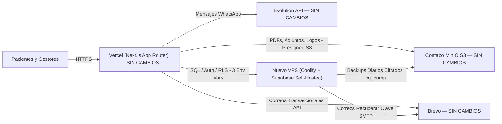

# Plan Arquitectónico y Operativo de Migración: Supabase Cloud Pro → Supabase Self-Hosted (VPS Propio)

> **Proyecto:** Salud360  
> **Fecha de elaboración:** Noviembre 2026  
> **Objetivo:** Eliminar el crecimiento variable de costos de Supabase Cloud Pro migrando la base de datos PostgreSQL, autenticación (`Auth`), políticas RLS, funciones SQL y el bucket auxiliar de plantillas a una instancia propia (**Self-Hosted**) administrada en un VPS, **manteniendo intactos Vercel, Contabo MinIO S3, Brevo y Evolution API**, garantizando **cero pérdida de información (Zero Data Loss)** y plan de retorno inmediato (*Rollback*).

---

## 1. Resumen Ejecutivo y Justificación Económica

| Concepto | Supabase Cloud Pro (Actual) | VPS Propio + Coolify + Supabase Self-Hosted |
| :--- | :--- | :--- |
| **Modelo de Cobro** | Base \$25 USD/mes + Compute + Egress (tráfico) + MAUs + Disk I/O (crece cada mes) | **Tarifa fija mensual** (aprox. \$10 – \$18 USD/mes en Contabo o Hetzner) |
| **Control de Recursos** | Limitado al plan (micro/small compute) | 100% dedicado (ej. 4 vCPU, 8 GB RAM, 100 GB NVMe) |
| **Límites de Tráfico / Filas** | Cobro por exceso de ancho de banda (*egress*) | Tráfico masivo incluido (decenas de TB/mes) |
| **Backups** | Incluidos en la nube (retención según plan) | Automatizados diariamente hacia tu servidor **MinIO S3** (retención 30+ días) |
| **Vercel / MinIO / Brevo** | Activos | **Se mantienen 100% iguales** |

---

## 2. Plataformas Recomendadas para Instalar Supabase y Conectar GitHub en tu Servidor

Las herramientas modernas de administración de servidores (**PaaS Self-Hosted**) que permiten instalar **Supabase completo en 1 clic** y además conectarse directamente a **GitHub** (para despliegues automáticos, scripts o servicios propios) son:

### Opción 1: **Coolify** *(Altamente Recomendada)*
* **Qué es:** Alternativa Open-Source y gratuita a Vercel/Render/Heroku instalada directamente en tu propio VPS Ubuntu/Debian.
* **Por qué es la mejor opción para Salud360:**
  1. Incluye plantilla oficial de **Supabase Self-Hosted en 1 clic** (levanta PostgreSQL, GoTrue Auth, PostgREST, Kong API Gateway, Studio, Storage y Meta automáticamente vía Docker Compose).
  2. **Integración nativa con GitHub** (mediante GitHub App o Deploy Keys) por si deseas conectar repositorios privados, ejecutar scripts o desplegar microservicios auxiliares en el mismo servidor.
  3. **Certificados SSL gratuitos y automáticos** (Let's Encrypt + proxy reverso Traefik) para exponer tu API de Supabase bajo tu propio subdominio HTTPS (ej. `https://db.tudominio.com`).
  4. **Backups programados de PostgreSQL hacia S3**: puedes apuntar los backups automáticos directamente a un bucket privado en tu servidor **Contabo MinIO S3**.

### Opción 2: **Dokploy** *(Alternativa ligera y muy moderna)*
* Similar a Coolify, basado en Docker + Traefik, interfaz muy intuitiva, plantilla de **Supabase en 1 clic**, integración directa con **GitHub** y backups programados a S3/MinIO. Consume muy poca memoria RAM del servidor.

### Opción 3: **Docker Compose Oficial de Supabase + Portainer** *(Control Manual)*
* Recomendado solo si prefieres administrar contenedores manualmente sin panel PaaS. Exige configurar manualmente el proxy reverso (Nginx/Caddy/Traefik), renovación SSL y scripts `cron` de backup.

> **Nota sobre GitHub:** Con **Coolify** o **Dokploy** conectas tu cuenta oficial de **GitHub** directamente desde el panel web (no necesitas instalar un clon de GitHub). Si algún día quisieras alojar repositorios Git privados 100% dentro de tu propio servidor sin usar GitHub.com, Coolify también permite instalar **Gitea** o **Forgejo** en 1 clic.

### Requisitos de Hardware Recomendados para el VPS de Supabase
* **Sistema Operativo:** Ubuntu 22.04 LTS o Ubuntu 24.04 LTS (limpio).
* **Memoria RAM:** Mínimo absoluto 4 GB — **Recomendado: 8 GB RAM** (el stack completo de Supabase con PostgreSQL + Kong + Auth + Studio + Analytics consume entre 2.2 GB y 3.5 GB en reposo, dejando margen holgado para picos de reportes y consultas concurrentes).
* **CPU:** 4 vCPU.
* **Almacenamiento:** 80 GB – 150 GB SSD/NVMe.
* **Ubicación recomendada:** US-East (Virginia / New York) para mantener latencia mínima (1–15 ms) con las funciones Serverless de **Vercel** (`iad1`), lo que hace que Salud360 sea incluso más rápido.

---

## 3. Arquitectura Objetivo: Qué Cambia y Qué Queda Intacto



### Servicios que NO se tocan (0 cambios de arquitectura)
1. **Contabo MinIO S3:** Todos los PDFs adjuntos de solicitudes, respuestas, firmas y logotipos (`MINIO_ENDPOINT`, `MINIO_ACCESS_KEY`, `MINIO_SECRET_KEY`, `MINIO_BUCKET_NAME`) **siguen exactamente igual**. Las URLs guardadas en la tabla `request_attachments` siguen apuntando al mismo servidor MinIO sin necesidad de migrar ni un solo PDF.
2. **Brevo:** Sigue enviando todos los correos transaccionales desde Vercel (`BREVO_API_KEY`, `BREVO_FROM_EMAIL`). Adicionalmente, configuraremos el SMTP de Brevo dentro del nuevo Supabase Self-Hosted para los correos de restablecimiento de contraseña (`resetPasswordForEmail`).
3. **Vercel:** El código de Salud360 sigue desplegado en Vercel con despliegue continuo desde GitHub. Al momento del corte, **solo se actualizan 3 variables de entorno en Vercel**:
   * `NEXT_PUBLIC_SUPABASE_URL`
   * `NEXT_PUBLIC_SUPABASE_ANON_KEY`
   * `SUPABASE_SERVICE_ROLE_KEY`
4. **Evolution API (WhatsApp):** Permanece intacta (`EVOLUTION_API_URL`, `EVOLUTION_API_KEY`).

---

## 4. Auditoría Real del Código de Salud360 (Inventario de lo que se Migra)

Al auditar el código fuente actual de Salud360, este es el inventario exacto de componentes que dependen de Supabase:

| Componente Supabase | ¿Lo usa Salud360? | Detalle Exacto en el Proyecto |
| :--- | :---: | :--- |
| **PostgreSQL (`schema public`)** | **SÍ (Crítico)** | 15 tablas principales (`institutions`, `users`, `roles`, `form_templates`, `requests`, `request_attachments`, `request_history`, `appointments`, `notifications_log`, `specialties`, `doctors`, `whatsapp_logs`, `legal_templates`, `branches`, `email_logs`), índices, llaves foráneas y secuencias. |
| **Funciones SQL y Políticas RLS** | **SÍ (Crítico)** | Función `public.get_user_profile()` y más de 25 políticas **Row Level Security (RLS)** de aislamiento multitenant por institución. |
| **Supabase Auth (`schema auth`)** | **SÍ (Crítico)** | Tablas `auth.users` y `auth.identities`. Los UUIDs de `auth.users.id` están enlazados directamente con `public.users.id`, `request_history.user_id` y campos de auditoría de `appointments`. **Se migran conservando los hashes `bcrypt` para que ningún usuario pierda su contraseña.** |
| **Supabase Storage** | **SÍ (Solo 1 bucket)** | **Hallazgo importante:** Aunque el 99% de archivos están en MinIO, el editor de plantillas legales (`src/components/admin/template-editor.tsx`) sube archivos `.docx` al bucket **`legal-templates`** de Supabase Storage. Debemos recrear este bucket y copiar esos archivos `.docx` al nuevo servidor (o moverlo a MinIO antes de migrar). |
| **Supabase Edge Functions** | **NO** | Toda la lógica backend vive en Next.js (Vercel). No hay Edge Functions que migrar. |
| **Supabase Realtime** | **NO** | No se usan canales WebSocket (`supabase.channel`). |

> [!TIP]
> El hecho de que Salud360 **no utilice Edge Functions ni Realtime** y ya almacene los PDFs en **MinIO** reduce drásticamente la complejidad técnica de esta migración.

---

## 5. Análisis de Riesgos y Protocolo "Cero Pérdida de Información"

### ¿Se corre riesgo de pérdida de información?
**Si se ejecuta sin protocolo, SÍ existen riesgos reales.** Sin embargo, aplicando el **Protocolo Zero-Data-Loss** detallado abajo, el riesgo de pérdida definitiva de datos se reduce a **prácticamente cero**, porque **nunca se borra ni se modifica la base de datos origen (Supabase Cloud Pro)** durante todo el proceso.

### Matriz de Riesgos y Mitigaciones Obligatorias

| Riesgo | Impacto | Causa Probable | Cómo lo Eliminamos por Completo |
| :--- | :---: | :--- | :--- |
| **1. Solicitudes radicadas durante la migración ("Delta perdido")** | Alto | Un paciente radica una solicitud en Supabase Cloud justo después de sacar el backup y antes de cambiar Vercel. | Activar el **Modo Mantenimiento del Portal** (ya existente en Salud360) durante una ventana nocturna de 30–45 min (ej. 11:30 PM) para congelar escrituras antes del `pg_dump` final. |
| **2. Usuarios sin acceso o contraseñas rotas** | Alto | Exportar solo el esquema `public` y olvidar `auth.users` / `auth.identities` o cambiar los UUIDs. | Exportar explícitamente los datos de `auth.users`, `auth.identities` y `auth.mfa_*` conservando los hashes `bcrypt` y UUIDs originales. |
| **3. Fallo en permisos multitenant (RLS)** | Alto | Errores de roles de Postgres (`anon`, `authenticated`, `service_role`) al restaurar políticas o funciones. | Restaurar usando el usuario `postgres` respetando la estructura de roles estándar de Supabase Self-Hosted y validar inicio de sesión con un **Gestor de Institución** y con **Super Admin** en ambiente *Preview* antes del corte. |
| **4. Plantillas `.docx` inaccesibles** | Medio | Olvidar migrar el bucket `legal-templates` de Supabase Storage. | Descargar todos los archivos de `legal-templates` en el backup previo y subirlos al nuevo bucket `legal-templates` (manteniendo exactamente el mismo `path`). |
| **5. Pérdida futura por falla del disco del VPS** | Crítico | En un VPS propio tú eres responsable de los backups (si el disco falla sin backup externo, se pierde la BD). | Configurar desde el Día 1 **backups automáticos diarios cifrados hacia tu otro servidor (Contabo MinIO S3)** + snapshot semanal del VPS. |

### Regla de Oro Antes de Empezar (Qué Hacer Antes para Garantizar Seguridad Total)
1. **NO cancelar ni pausar Supabase Cloud Pro** hasta haber operado **al menos 10 a 15 días sin incidentes** en el servidor propio.
2. **Guardar 2 copias locales encriptadas** del respaldo completo (esquema + datos `public` + datos `auth` + bucket `legal-templates`) en tu equipo y en un bucket privado de MinIO antes de tocar nada.
3. **Realizar primero un Ensayo Completo (*Dry-Run*)** sin afectar producción, conectando un **despliegue Preview de Vercel** (rama de prueba) al nuevo Supabase Self-Hosted para probar todo de punta a punta.
4. **Tener listo el Plan de Rollback (< 3 minutos):** Si al pasar a producción ocurriera cualquier error inesperado, solo restauras las 3 variables de entorno originales en Vercel y haces *Redeploy*; el sistema vuelve a Supabase Cloud Pro intacto en menos de 3 minutos.

---

## 6. Plan Técnico de Ejecución Paso a Paso

### Fase 0: Preparación Previa (Sin tiempo fuera de servicio)
1. Adquirir/preparar el VPS (Ubuntu 22.04/24.04 LTS, 8 GB RAM, 4 vCPU, NVMe, preferiblemente región US-East).
2. Crear un registro DNS tipo `A` en tu proveedor de dominio (ej. Cloudflare / Hostinger / Namecheap):
   * `db.tudominio.com` → IP pública del nuevo VPS.
3. Obtener la **Connection String directa** de tu actual **Supabase Cloud Pro** (*Project Settings → Database → Connection string → Direct / Session Pooler*, usuario `postgres`).
4. Verificar que tienes instaladas las herramientas de cliente PostgreSQL (`pg_dump` y `psql`, versión 15 o 16, coincidente con la versión de Postgres de tu Supabase actual).

---

### Fase 1: Instalación de Coolify y Despliegue de Supabase Self-Hosted
1. **Asegurar el servidor (Firewall + SSH):**
   * Abrir únicamente puertos `22` (SSH), `80` (HTTP), `443` (HTTPS) y temporalmente `8000` (panel Coolify durante la configuración inicial, luego cerrarlo y exponer Coolify por subdominio HTTPS).
2. **Instalar Coolify en el VPS:**
   ```bash
   curl -fsSL https://cdn.coollabs.io/coolify/install.sh | bash
   ```
3. **Conectar GitHub en Coolify (opcional/recomendado):**
   * En Coolify → *Sources → Add GitHub App* para vincular tu cuenta de GitHub de forma segura.
4. **Desplegar Supabase Self-Hosted en 1 clic:**
   * En Coolify → *Projects → New Resource → Services → Supabase*.
   * Asignar el dominio HTTPS `https://db.tudominio.com` al servicio **Kong** (API Gateway de Supabase).
   * Configurar en las variables de entorno del stack de Supabase:
     * `SITE_URL=https://tu-dominio-salud360.com`
     * `ADDITIONAL_REDIRECT_URLS=https://tu-dominio-salud360.com/auth/callback,https://tu-dominio-salud360.com/login/reset-password`
     * **SMTP de Brevo** (`SMTP_HOST=smtp-relay.brevo.com`, `SMTP_PORT=587`, `SMTP_USER`, `SMTP_PASS`, `SMTP_ADMIN_EMAIL`) para que los correos de recuperación de contraseña funcionen sin límites.
   * Guardar de forma segura en un gestor de contraseñas las nuevas credenciales generadas por Coolify:
     * `SERVICE_ROLE_KEY`
     * `ANON_KEY`
     * `POSTGRES_PASSWORD`
     * `JWT_SECRET`
5. **Verificar salud del stack:**
   * Abrir Supabase Studio en el nuevo servidor y confirmar que PostgreSQL, Auth, REST y Storage muestran estado **Healthy**.

---

### Fase 2: Ensayo General (*Dry-Run*) — Migración de Prueba sin Afectar Producción

> **Importante:** En esta fase **Salud360 en producción sigue operando 100% en Supabase Cloud Pro** sin que nadie note nada.

1. **Exportar estructura y datos desde Supabase Cloud Pro:**
   Separar `auth` (solo datos) y `public` (esquema + datos + funciones + políticas RLS) evita conflictos con esquemas internos administrados por la nueva versión de Supabase:
   ```bash
   # 1. Respaldo completo de seguridad (archivo de referencia inmutable)
   pg_dump "$SUPABASE_CLOUD_DB_URL" \
     --format=custom --no-owner --no-privileges \
     -f backup_completo_salud360_$(date +%Y%m%d).dump

   # 2. Esquema + funciones + triggers + políticas RLS de 'public'
   pg_dump "$SUPABASE_CLOUD_DB_URL" \
     --schema=public --schema-only --no-owner --no-privileges \
     -f 01_public_schema.sql

   # 3. Datos de usuarios de autenticación (preserva UUIDs y contraseñas bcrypt)
   pg_dump "$SUPABASE_CLOUD_DB_URL" \
     --data-only --no-owner --no-privileges \
     --table=auth.users \
     --table=auth.identities \
     -f 02_auth_data.sql

   # 4. Datos completos de negocio del esquema 'public'
   pg_dump "$SUPABASE_CLOUD_DB_URL" \
     --schema=public --data-only --no-owner --no-privileges \
     --disable-triggers \
     -f 03_public_data.sql
   ```

2. **Restaurar en el nuevo Supabase Self-Hosted:**
   ```bash
   # 1. Crear tablas, índices, funciones SQL (get_user_profile) y políticas RLS
   psql "$SUPABASE_SELFHOSTED_DB_URL" -v ON_ERROR_STOP=1 -f 01_public_schema.sql

   # 2. Restaurar usuarios y contraseñas en 'auth'
   psql "$SUPABASE_SELFHOSTED_DB_URL" -v ON_ERROR_STOP=1 -f 02_auth_data.sql

   # 3. Restaurar todos los datos del negocio en 'public'
   psql "$SUPABASE_SELFHOSTED_DB_URL" -v ON_ERROR_STOP=1 -f 03_public_data.sql
   ```

3. **Migrar el bucket `legal-templates`:**
   * Crear el bucket `legal-templates` en Supabase Studio del nuevo servidor (con los mismos permisos de acceso).
   * Copiar los archivos `.docx` descargados de Supabase Cloud Pro al nuevo bucket manteniendo exactamente el mismo nombre de archivo (`docx_file_path`).

4. **Auditoría Matemática de Integridad (Origen vs. Destino):**
   Ejecutar la siguiente consulta en **ambas bases de datos** y confirmar que **todos los números coinciden 1 a 1**:
   ```sql
   SELECT 'auth.users' AS tabla, COUNT(*) FROM auth.users
   UNION ALL SELECT 'public.users', COUNT(*) FROM public.users
   UNION ALL SELECT 'institutions', COUNT(*) FROM public.institutions
   UNION ALL SELECT 'roles', COUNT(*) FROM public.roles
   UNION ALL SELECT 'form_templates', COUNT(*) FROM public.form_templates
   UNION ALL SELECT 'requests', COUNT(*) FROM public.requests
   UNION ALL SELECT 'request_attachments', COUNT(*) FROM public.request_attachments
   UNION ALL SELECT 'request_history', COUNT(*) FROM public.request_history
   UNION ALL SELECT 'appointments', COUNT(*) FROM public.appointments
   UNION ALL SELECT 'doctors', COUNT(*) FROM public.doctors
   UNION ALL SELECT 'specialties', COUNT(*) FROM public.specialties
   UNION ALL SELECT 'branches', COUNT(*) FROM public.branches
   UNION ALL SELECT 'legal_templates', COUNT(*) FROM public.legal_templates
   UNION ALL SELECT 'whatsapp_logs', COUNT(*) FROM public.whatsapp_logs
   UNION ALL SELECT 'email_logs', COUNT(*) FROM public.email_logs
   ORDER BY tabla;
   ```

5. **Validación Funcional en Entorno Preview de Vercel:**
   * Crear una rama temporal o configurar las 3 variables nuevas únicamente en el entorno **Preview** de Vercel.
   * Probar:
     - [ ] Login con usuario Super Admin y con usuario Gestor (con su contraseña actual sin cambiarla).
     - [ ] Aislamiento RLS: confirmar que un Gestor solo ve solicitudes de su institución.
     - [ ] Visualizar PDFs adjuntos antiguos (confirmar que descargan sin problemas desde **Contabo MinIO S3**).
     - [ ] Radicar una solicitud de prueba desde el Portal Paciente (subiendo un PDF a MinIO) y validar correo de **Brevo**.
     - [ ] Agendar, reprogramar y cancelar una cita en `/admin/appointments`.
     - [ ] Abrir todos los módulos del **Centro de Reportes** (`/admin/reports`).
     - [ ] Probar "Olvidé mi contraseña" para verificar el SMTP de Brevo en GoTrue.

---

### Fase 3: Ventana de Corte a Producción (*Cutover Nocturno*)

> **Horario sugerido:** Noche/Madrugada de menor tráfico (ej. 11:00 PM – 12:00 AM COT).  
> **Duración de la ventana de mantenimiento:** **30 a 45 minutos**.

1. **T+00 min — Congelar escrituras (Zero Delta):**
   * Activar el **Modo Mantenimiento del Portal** en Salud360 (para que ningún paciente radique durante los 30 minutos del corte) y avisar a los gestores que no operen durante la ventana.
2. **T+05 min — Extracción Final Limpia:**
   * Ejecutar los comandos `pg_dump` de la Fase 2 sobre **Supabase Cloud Pro** para capturar hasta el último registro creado antes de la ventana.
3. **T+12 min — Limpieza de datos de prueba y Restauración Final:**
   * Vaciar el ensayo previo en el nuevo Supabase Self-Hosted y restaurar `01_public_schema.sql`, `02_auth_data.sql` y `03_public_data.sql`.
4. **T+20 min — Validación de Conteos (`COUNT(*)`):**
   * Confirmar 100% de paridad en todas las tablas (`auth.users`, `requests`, `appointments`, `request_attachments`, etc.).
5. **T+25 min — Cambio de Puntero en Vercel (Cutover):**
   * En Vercel → *Project Settings → Environment Variables (Production)*, actualizar únicamente:
     * `NEXT_PUBLIC_SUPABASE_URL` → `https://db.tudominio.com`
     * `NEXT_PUBLIC_SUPABASE_ANON_KEY` → Nueva Anon Key
     * `SUPABASE_SERVICE_ROLE_KEY` → Nueva Service Role Key
   * Ejecutar **Redeploy** en producción (toma ~1–2 minutos).
6. **T+30 min — Pruebas de Humo (*Smoke Tests*) en Producción:**
   * Iniciar sesión en el panel administrativo.
   * Verificar carga de solicitudes, citas del día, descarga de un PDF desde MinIO y módulo de reportes.
   * Hacer una radicación de prueba y verificar envío de correo por Brevo (luego eliminar la solicitud de prueba si se desea).
7. **T+38 min — Reapertura:**
   * Desactivar el Modo Mantenimiento del Portal. **¡Producción operando 100% en Supabase Self-Hosted!**

---

### Fase 4: Backups Automáticos, Descarga Local al PC, Monitoreo y Cierre de Supabase Pro

1. **Backups Automáticos Diarios a MinIO S3 (Servidor Secundario):**
   * Crear un bucket privado exclusivo en tu servidor Contabo MinIO (ej. `salud360-db-backups`).
   * Configurar en **Coolify** (o mediante `cron` diario a las 2:00 AM COT) el respaldo comprimido y **cifrado con clave maestra (AES-256)** de PostgreSQL hacia ese bucket S3 con política de retención de **30 días**.
   * Beneficio: si el VPS de Supabase llegara a fallar físicamente, tus respaldos están a salvo en **otro servidor independiente (MinIO)**.

2. **Descarga Local de Backups a tu Propio PC / Disco Externo (Cumplimiento Regla 3-2-1):**
   Para protegerte incluso ante un fallo simultáneo del servidor de MinIO, mantendrás una tercera copia **fuera de la nube (local en tu PC o disco duro externo)** mediante cualquiera de estas opciones:
   * **Opción A — Descarga manual en 1 clic (Consola Web de MinIO):**
     - Ingresas al panel web de MinIO → abres el bucket privado `salud360-db-backups` → seleccionas el archivo del día (ej. `salud360_2026-11-26.dump.gz.enc`, normalmente entre 5 MB y 50 MB) → clic en **Download**.
   * **Opción B — Descarga automatizada en Windows (`rclone` o MinIO Client `mc`):**
     - Dejaremos un script local en tu PC (ejecutable con doble clic o programado semanalmente en el *Programador de Tareas de Windows*) que sincroniza automáticamente los backups nuevos desde MinIO hacia una carpeta local o disco externo USB.
     - Ejemplo con `rclone` / `mc` (descarga incremental, solo trae archivos nuevos):
       ```powershell
       # Descargar backups diarios de la base de datos a tu PC
       mc mirror minio-contabo/salud360-db-backups "D:\Backups_Salud360\DB"

       # Opcional (mensual): copia incremental de los PDFs adjuntos a un disco externo
       mc mirror minio-contabo/tu-bucket-pdfs "D:\Backups_Salud360\PDFs"
       ```
   * **Seguridad y Cumplimiento Legal (Ley 1581 de 2012 — Datos de Salud):**
     - Como el backup de la base de datos contiene datos sensibles de pacientes (nombres, documentos, teléfonos, correos y solicitudes médicas), el archivo se **comprime y cifra con AES-256** antes de salir del VPS hacia MinIO. De esta manera, la copia almacenada en MinIO y la descargada en tu PC o disco externo permanecen protegidas contra accesos no autorizados.

3. **Periodo de Estabilización (10 a 15 días):**
   * Mantener **Supabase Cloud Pro** en modo lectura/espera sin cancelarlo durante 10–15 días.
   * Monitorear consumo de RAM, CPU y disco en Coolify (debe mantenerse por debajo del 60% de RAM y 70% de disco).

4. **Cancelación de Supabase Cloud Pro:**
   * Una vez cumplidos 15 días de operación estable y verificado que al menos 1 backup automático descargado desde MinIO se restaura correctamente, cancelar/bajar a Free el proyecto de Supabase Cloud Pro.

---

## 7. Plan de Retorno de Emergencia (*Rollback* en < 3 Minutos)

Si durante la noche del corte o en las primeras horas detectáramos cualquier falla crítica:
1. Ir a **Vercel → Environment Variables (Production)**.
2. Restaurar los 3 valores anteriores de **Supabase Cloud Pro** (`NEXT_PUBLIC_SUPABASE_URL`, `NEXT_PUBLIC_SUPABASE_ANON_KEY`, `SUPABASE_SERVICE_ROLE_KEY`).
3. Presionar **Redeploy** (o promover el deployment anterior desde la pestaña *Deployments* de Vercel).
4. En menos de **3 minutos**, Salud360 vuelve a operar exactamente como estaba antes del corte sin pérdida de historial.

---

## 8. Cronograma Estimado de Tiempos de Ejecución

| Fase | Descripción | Tiempo Estimado | ¿Afecta a Producción? |
| :--- | :--- | :---: | :---: |
| **Fase 0** | Contratación/acceso VPS, DNS (`db.tudominio.com`) y credenciales | 30 min | **No** |
| **Fase 1** | Instalación de **Coolify**, despliegue de **Supabase Self-Hosted**, SSL y SMTP Brevo | 1.5 – 2 horas | **No** |
| **Fase 2** | **Ensayo General (*Dry-Run*)**: `pg_dump`, restauración, migración de `legal-templates`, verificación `COUNT(*)` y pruebas en Vercel Preview | 2 – 3 horas | **No** |
| **Fase 3** | **Corte Real Nocturno (*Cutover*)**: modo mantenimiento, dump final, restauración, cambio de 3 variables en Vercel y pruebas de humo | **30 – 45 min** | **Sí (ventana nocturna)** |
| **Fase 4** | Configuración de backups automáticos hacia **MinIO S3** y alertas de servidor | 1 hora | **No** |
| **Observación** | Monitoreo en vivo antes de cancelar Supabase Cloud Pro | 10 – 15 días | **No** |
| **TOTAL** | **Esfuerzo técnico total** | **~5.5 – 7 horas** | **Solo 30–45 min de mantenimiento** |

---

## 9. Checklist Rápido Antes de Iniciar

- [ ] VPS contratado (Ubuntu 22.04/24.04, **8 GB RAM recomendados**, 4 vCPU, 100 GB NVMe, región US-East).
- [ ] Subdominio creado para el nuevo Supabase (ej. `db.salud360...` o `supabase.tudominio.com`).
- [ ] Acceso al panel de **Vercel** (para cambiar las 3 variables de entorno y probar en Preview).
- [ ] Acceso al panel de **Supabase Cloud Pro** (para obtener el Connection String directo de Postgres y descargar `legal-templates`).
- [ ] Credenciales SMTP de **Brevo** a la mano (para correos de Auth / recuperación de contraseña).
- [ ] Bucket privado nuevo en **Contabo MinIO S3** listo para recibir los backups automáticos diarios cifrados (AES-256) de PostgreSQL.
- [ ] Carpeta local en tu PC (o disco externo USB) + script `mc`/`rclone` definido para descargar copias locales periódicas desde MinIO (Regla 3-2-1).
